# 🏗️ Arquitectura Frontend de ClassTrack (`classtrack.web`)

Este documento define la arquitectura oficial, los patrones de diseño y los estándares de organización del proyecto web para el sistema **ClassTrack**.

---

## 1. Filosofía Arquitectónica: Modular por Features

La aplicación adopta una **Arquitectura Guiada por Features (Feature-Driven / Vertical Slicing)**.

### Principios Fundamentales:
1. **Alta cohesión y bajo acoplamiento:** Todo lo que pertenezca al dominio de una funcionalidad (componentes, lógica, contratos y servicios) vive en su propio módulo.
2. **Encapsulamiento:** Las dependencias internas de una funcionalidad no deben exponerse indiscriminadamente a otros módulos. Cada feature expone una API pública limpia (`index.ts`).
3. **Escalabilidad y mantenibilidad:** Agregar una nueva funcionalidad o modificar una existente no afecta al resto de la aplicación.
4. **Flujo de datos predecible:**
   $$\text{Vista / Componente} \longrightarrow \text{Custom Hook} \longrightarrow \text{Service (API)} \longrightarrow \text{Backend (NestJS)}$$

---

## 2. Estructura Global del Proyecto (`src/`)

```text
src/
├── assets/                  # Logotipos, imágenes institucionales, favicons, SVGs
├── config/                  # Constantes globales, configuración de entorno tipada
│   └── env.ts
├── features/                # 🚀 Módulos funcionales de negocio (arquitectura modular)
│   ├── auth/                # Login, activación, recuperación y cambio de clave
│   ├── dashboard/           # Métricas, KPIs y resúmenes operativos por rol
│   ├── attendance/          # Planilla de asistencia, ventana 72h, auditoría y correcciones
│   ├── sessions/            # Clases del día, reprogramaciones y cancelaciones
│   ├── schedules/           # Matriz semanal de horarios y prevención de cruces
│   ├── academic/            # Aulas, materias, grupos, directores, matrículas y calendario
│   ├── users/               # Directorio institucional (docentes, estudiantes, coordinadores)
│   ├── imports/             # Cargas masivas atómicas con Excel (.xlsx) y plantillas
│   ├── reports/             # Generación y descarga directa de informes Excel
│   └── schools/             # Portal Super Admin (gestión y aprovisionamiento de colegios)
├── layouts/                 # Plantillas de diseño responsivas
│   ├── AuthLayout.tsx       # Layout para login, activación y recuperación
│   ├── DashboardLayout.tsx  # Layout principal con Sidebar, Topbar, Notificaciones y SchoolSwitcher
│   └── MobileSheetLayout.tsx# Layout optimizado para docentes en móvil/tablet
├── routes/                  # Configuración de rutas y guards de acceso
│   ├── AppRouter.tsx        # Árbol de rutas de la aplicación
│   ├── ProtectedRoute.tsx   # Guardia de sesión activa (JWT)
│   └── RoleGuard.tsx        # Guardia por roles y perfiles institucionales
├── shared/                  # 🌐 Elementos comunes y transversales
│   ├── components/
│   │   ├── ui/              # Button, Input, Select, Modal, Badge, Table, Card, Tabs
│   │   ├── feedback/        # Loader, Toast, ConfirmModal, EmptyState, TimeRemainingAlert
│   │   └── navigation/      # SchoolSwitcher, Breadcrumbs, Navbar, Sidebar
│   ├── context/             # AuthContext, CollegeTimeContext, ToastContext
│   ├── hooks/               # useCollegeTime, useDebounce, useMediaQuery, useLocalStorage
│   ├── interfaces/          # PaginatedResponse<T>, ApiError, UserProfile, TenantProfile
│   ├── services/            # Instancia centralizada de Axios con interceptores JWT
│   └── utils/               # Formateo de fechas, cálculo de asistencia, validadores
├── App.tsx                  # Componente raíz con proveedores globales
├── index.css                # Configuración de Tailwind CSS v4
└── main.tsx                 # Entrada de la aplicación React 19
```

---

## 3. Anatomía Estricta de un Feature

Cada carpeta dentro de `src/features/[feature-name]/` debe estructurarse obligatoriamente de la siguiente manera:

```text
src/features/[feature-name]/
├── components/              # Componentes de UI exclusivos de este feature
├── hooks/                   # Custom hooks con la lógica y estado de la funcionalidad
├── interfaces/              # Contratos TypeScript (DTOs, modelos, estados y props)
├── services/                # Servicios HTTP que consumen los endpoints de la API
├── pages/                   # Vistas/pantallas del feature listas para el enrutador
└── index.ts                 # API pública del feature (lo que se exporta al exterior)
```

### Reglas de cada subcarpeta:

| Carpeta | Responsabilidad | Lo que SÍ contiene | Lo que NO contiene |
|---|---|---|---|
| **`components/`** | Renderizado visual y presentación. | Tablas especializadas, formularios del dominio, modales de confirmación de la funcionalidad. | Llamadas directas a la API (`axios`/`fetch`). Lógica de negocio pesada. |
| **`hooks/`** | Estado reactivo y efectos secundarios. | `useState`, `useEffect`, llamadas a servicios, estados `isLoading`, validaciones de formulario. | Marcado JSX visual. |
| **`interfaces/`** | Contratos de datos tipados. | DTOs de petición y respuesta, enums de negocio, modelos de entidad, props de componentes. | Código JavaScript/TypeScript ejecutable o componentes. |
| **`services/`** | Comunicación con la API REST. | Funciones asíncronas con `apiClient`, mapeo de respuestas, serialización de payloads. | Hooks de React (`useState`, `useNavigate`). |
| **`pages/`** | Ensamblado de vistas completas. | Conecta el layout con los componentes y custom hooks de la página. | Lógica de llamada API no mediada por hooks. |
| **`index.ts`** | Encapsulamiento del módulo. | Exporta únicamente las páginas y componentes públicos que requiere el Router u otros módulos autorizados. | Nada que sea estrictamente privado del módulo. |

---

## 4. Mapa Detallado de Features (Alineado con Backend y Reglas)

```mermaid
graph TD
    subgraph CoreFeatures ["Módulos de Negocio (Features)"]
        AUTH["auth\n(Login, Multi-Colegio, Activación, Reset Clave)"]
        DASH["dashboard\n(KPIs, Resumen de hoy según rol)"]
        ATTEND["attendance\n(Planilla, 72h, P/T/A/E, Auditoría)"]
        IMPORTS["imports\n(Cargas Masivas Excel Todo o Nada)"]
        SESS["sessions\n(Clases de hoy, Reprogramar, Cancelar)"]
        SCHED["schedules\n(Matriz de horarios y Cruces)"]
        ACAD["academic\n(Aulas, Materias, Grupos, Matrículas, Calendario)"]
        USERS["users\n(Docentes, Alumnos, Admins, Reenvío Invitación)"]
        REP["reports\n(Exportación Oficial Excel Resumen/Detalle)"]
        SCH["schools\n(Portal Super Admin Aprovisionamiento)"]
    end

    subgraph SharedLayer ["Capa Transversal (shared)"]
        HTTP["HTTP Client (Axios + JWT Interceptors)"]
        TIME["CollegeTime Sync (Zona Horaria Colegio)"]
        SWITCH["SchoolSwitcher (Multi-Tenancy)"]
        UI["UI Kit (Botones, Modales, Tablas, Badges)"]
    end

    AUTH --> HTTP
    ATTEND --> HTTP
    ATTEND --> TIME
    IMPORTS --> HTTP
    SESS --> HTTP
    SCHED --> HTTP
    ACAD --> HTTP
    USERS --> HTTP
    REP --> HTTP
    SCH --> HTTP
    DASH --> HTTP
```



---

### 4.1. `auth`
- **Responsabilidad:** Autenticación global, selección de perfil de colegio, activación por correo y recuperación de contraseñas.
- **Endpoints:**
  - `POST /api/auth/login` (rate limit: 5 req/min)
  - `POST /api/auth/activate` (vigencia token: 48h)
  - `POST /api/auth/forgot-password` (código 6 dígitos, vigencia 5 min)
  - `POST /api/auth/reset-password`
  - `PATCH /api/auth/change-password`
  - `GET /api/auth/profile`
- **Estructura Interna:**
  - `components/`: `LoginForm.tsx`, `CollegeSelectorModal.tsx`, `PasswordStrengthMeter.tsx`, `CountdownTimer.tsx`, `ChangePasswordModal.tsx`.
  - `hooks/`: `useLogin.ts`, `useActivation.ts`, `usePasswordRecovery.ts`, `useChangePassword.ts`.
  - `interfaces/`: `auth.types.ts` (`LoginRequestDto`, `AuthResponseDto`, `UserProfile`, `TenantProfile`).
  - `services/`: `auth.service.ts`.
  - `pages/`: `LoginPage.tsx`, `ActivateAccountPage.tsx`, `ForgotPasswordPage.tsx`, `ResetPasswordPage.tsx`.

---

### 4.2. `attendance` (Módulo Crítico)
- **Responsabilidad:** Toma de asistencia rápida, motor de control de las **72 horas**, historial inmutable de auditoría y correcciones administrativas con motivo obligatorio.
- **Reglas de Negocio:**
  - Plazo docente: exactamente 72 horas desde `start_time` del colegio.
  - Al superar 72 horas o al modificar asistencias previas, el sistema exige un campo `reason` (motivo) guardado en `attendance_audit`.
  - Director de grupo puede corregir asistencias de su grupo sin límite de 72 horas.
  - Estados individuales:
    - `present` (Presente)
    - `late` (Tarde)
    - `absent` (Ausente) $\rightarrow$ Activa trabajo en segundo plano con ventana de cortesía de 30 min hacia n8n.
    - `excused` (Excusado con soporte)
    - `not_registered` (No registrado aún)
    - `cancelled` (Clase cancelada, no computable como falta)
  - Fórmula oficial de porcentaje:
    $$\% \text{ Asistencia} = \left[ \frac{\text{Presentes} + \text{Tardes}}{\text{Clases Válidas} - \text{Excusadas}} \right] \times 100$$
- **Endpoints:**
  - `POST /api/attendance/session/:sessionId` (registro/modificación con validación de ventana)
  - `GET /api/attendance/session/:sessionId` (lectura de planilla de la sesión)
  - `GET /api/attendance/session/:sessionId/audit` (historial de cambios)
- **Estructura Interna:**
  - `components/`: `AttendanceSheetTable.tsx`, `AttendanceQuickActions.tsx`, `WindowTimerBadge.tsx`, `AuditHistoryDrawer.tsx`, `CorrectionReasonModal.tsx`, `ExcuseModal.tsx`.
  - `hooks/`: `useAttendanceSheet.ts`, `useAttendanceWindow.ts`, `useAttendanceAudit.ts`.
  - `interfaces/`: `attendance.types.ts` (`AttendanceRecord`, `SaveSessionAttendanceDto`, `AttendanceAuditItem`, `AttendanceStatusEnum`).
  - `services/`: `attendance.service.ts`.
  - `pages/`: `AttendanceSheetPage.tsx`, `GroupAttendanceHistoryPage.tsx`.

---

### 4.3. `imports` (Cargas Masivas con Excel)
- **Responsabilidad:** Carga atómica (*"Todo o Nada"*) de información institucional mediante archivos `.xlsx`, descarga de plantillas oficiales con ejemplos y visor interactivo de errores por fila.
- **Endpoints:**
  - `GET /api/imports/templates/:type` (`students`, `teachers`, `schedules`) $\rightarrow$ Descarga binaria `.xlsx`.
  - `POST /api/imports/students` (multipart/form-data)
  - `POST /api/imports/teachers` (multipart/form-data)
  - `POST /api/imports/schedules` (multipart/form-data)
- **Estructura Interna:**
  - `components/`: `DropzoneExcel.tsx`, `TemplateDownloadButton.tsx`, `ImportErrorTable.tsx`, `ImportSuccessSummary.tsx`.
  - `hooks/`: `useBulkImport.ts`, `useTemplateDownload.ts`.
  - `interfaces/`: `import.types.ts` (`BulkImportResponse`, `ImportRowError`, `ImportType`).
  - `services/`: `imports.service.ts`.
  - `pages/`: `BulkImportsPage.tsx`.

---

### 4.4. `sessions`
- **Responsabilidad:** Vista de sesiones de clase del día para el docente, reprogramación (creación de sesión vinculada sin duplicar registros) y cancelación de clases (con invalidación de avisos de inasistencia pendientes).
- **Endpoints:**
  - `GET /api/sessions` (listado con filtros de fecha, estado, docente, grupo)
  - `POST /api/sessions/:id/reschedule`
  - `POST /api/sessions/:id/cancel`
- **Estructura Interna:**
  - `components/`: `TodaySessionCard.tsx`, `SessionStatusBadge.tsx`, `RescheduleSessionModal.tsx`, `CancelSessionModal.tsx`.
  - `hooks/`: `useTodaySessions.ts`, `useSessionActions.ts`.
  - `interfaces/`: `session.types.ts` (`ClassSession`, `SessionStatusEnum`, `RescheduleDto`, `CancelSessionDto`).
  - `services/`: `session.service.ts`.
  - `pages/`: `TeacherTodaySessionsPage.tsx`, `SessionsCalendarPage.tsx`.

---

### 4.5. `schedules`
- **Responsabilidad:** Matriz visual de horarios semanales (Lunes a Viernes) y detección preventiva en tiempo real de cruces de docentes, aulas o grupos.
- **Endpoints:**
  - `GET /api/schedules`
  - `POST /api/schedules`
  - `DELETE /api/schedules/:id`
- **Estructura Interna:**
  - `components/`: `WeeklyScheduleGrid.tsx`, `ScheduleSlotCard.tsx`, `ScheduleFormModal.tsx`, `ConflictAlert.tsx`.
  - `hooks/`: `useWeeklySchedules.ts`, `useScheduleConflictChecker.ts`.
  - `interfaces/`: `schedule.types.ts` (`ScheduleSlot`, `CreateScheduleDto`, `ScheduleConflictError`).
  - `services/`: `schedule.service.ts`.
  - `pages/`: `SchedulesMatrixPage.tsx`.

---

### 4.6. `academic`
- **Responsabilidad:** Estructura escolar integral: Aulas (capacidad y disponibilidad), Asignaturas, Grupos, Asignación de docentes, Matrículas, Cambio de grupo (conservando historial) y Calendario Escolar (festivos y bimestres).
- **Reglas Específicas:**
  - Un docente solo puede dirigir **máximo 1 grupo**.
  - No se puede retirar a un director de grupo sin asignarle un reemplazo en la misma operación.
  - El cambio de grupo es exclusivo del Administrador y debe conservar el historial académico previo.
- **Endpoints:**
  - `/api/academic/classrooms` (GET, POST)
  - `/api/academic/subjects` (GET, POST)
  - `/api/academic/groups` (GET, POST, GET :id)
  - `PATCH /api/academic/groups/:id/director` (asignación/reemplazo)
  - `POST /api/academic/teacher-assignments`
  - `POST /api/academic/enrollments`
  - `POST /api/academic/enrollments/change-group`
  - `/api/academic/calendar` (GET, POST: festivos, vacaciones y periodos)
- **Estructura Interna:**
  - `components/`: `ClassroomTable.tsx`, `SubjectList.tsx`, `GroupCard.tsx`, `DirectorAssignmentModal.tsx`, `ChangeGroupModal.tsx`, `SchoolCalendarGrid.tsx`.
  - `hooks/`: `useAcademicStructure.ts`, `useGroupDetail.ts`, `useSchoolCalendar.ts`.
  - `interfaces/`: `academic.types.ts` (`Classroom`, `Subject`, `Group`, `Enrollment`, `SchoolCalendarEvent`).
  - `services/`: `academic.service.ts`.
  - `pages/`: `AcademicStructurePage.tsx`, `GroupDetailPage.tsx`, `CalendarSettingsPage.tsx`.

---

### 4.7. `users`
- **Responsabilidad:** Directorio institucional de Docentes, Estudiantes y Administradores de Colegio. Creación manual y botón de reenvío de enlace de activación (48h).
- **Endpoints:**
  - `GET /api/users` (`?page=1&limit=20&role=teacher`)
  - `POST /api/users`
  - `POST /api/users/:id/resend-activation`
- **Estructura Interna:**
  - `components/`: `UserTable.tsx`, `UserFormModal.tsx`, `ResendActivationButton.tsx`, `UserRoleBadge.tsx`.
  - `hooks/`: `useUsersList.ts`, `useUserMutations.ts`.
  - `interfaces/`: `user.types.ts` (`SchoolUser`, `CreateUserDto`, `UserFilterQuery`).
  - `services/`: `user.service.ts`.
  - `pages/`: `UsersDirectoryPage.tsx`.

---

### 4.8. `dashboard`
- **Responsabilidad:** Panel de control principal con KPIs consolidados según el perfil autenticado.
- **Endpoints:**
  - `GET /api/dashboard/stats`
- **Estructura Interna:**
  - `components/`: `KpiCard.tsx`, `WeeklyAttendanceTrend.tsx`, `TeacherTodaySummary.tsx`.
  - `hooks/`: `useDashboardStats.ts`.
  - `interfaces/`: `dashboard.types.ts` (`DashboardStatsDto`).
  - `services/`: `dashboard.service.ts`.
  - `pages/`: `SchoolAdminDashboardPage.tsx`, `TeacherDashboardPage.tsx`, `StudentDashboardPage.tsx`.

---

### 4.9. `reports`
- **Responsabilidad:** Descarga de reportes oficiales en Excel (.xlsx) estructurados en dos hojas: **Resumen** (estadísticas por alumno) y **Detalle** (histórico sesión a sesión con auditoría).
- **Endpoints:**
  - `GET /api/reports/excel?startDate=...&endDate=...&groupId=...`
- **Estructura Interna:**
  - `components/`: `ReportFilterForm.tsx`, `ExcelDownloadButton.tsx`.
  - `hooks/`: `useExcelReports.ts`.
  - `interfaces/`: `report.types.ts` (`ReportFilterDto`).
  - `services/`: `report.service.ts`.
  - `pages/`: `ReportsPage.tsx`.

---

### 4.10. `schools` (Módulo Super Administrador)
- **Responsabilidad:** Aprovisionamiento dinámico de nuevos colegios contratantes (ejecuta la creación transaccional del esquema PostgreSQL `tenant_<slug>` en Supabase) y métricas globales del SaaS.
- **Endpoints:**
  - `GET /api/schools`
  - `POST /api/schools`
  - `GET /api/health`
- **Estructura Interna:**
  - `components/`: `SchoolDirectoryTable.tsx`, `CreateSchoolModal.tsx`, `SchoolProvisioningStatus.tsx`.
  - `hooks/`: `useSchoolsDirectory.ts`, `useSchoolProvisioning.ts`.
  - `interfaces/`: `school.types.ts` (`School`, `CreateSchoolDto`).
  - `services/`: `school.service.ts`.
  - `pages/`: `SuperAdminDashboardPage.tsx`.

---

## 5. Capa Compartida (`src/shared/`)

### 5.1. Sincronización Horaria y Regla de 72h (`shared/hooks/useCollegeTime.ts`)
Para evitar discrepancias entre el reloj del navegador del docente y la zona horaria institucional (ej. `America/Bogota`):
- Un hook centralizado calcula el delta de tiempo con la hora del servidor y computa el tiempo restante de la ventana de 72 horas con precisión exacta.
- Expone:
  - `isExpired: boolean`
  - `hoursLeft: number`
  - `minutesLeft: number`
  - `warningThreshold: boolean` (alerta no bloqueante cuando la clase ya terminó pero está dentro de las 72h)

### 5.2. Selector Multi-Colegio (`shared/components/navigation/SchoolSwitcher.tsx`)
- Ubicado en el Topbar.
- Permite a usuarios con múltiples asignaciones o al Super Administrador alternar entre colegios sin cerrar sesión, actualizando el `activeProfile` y las cabeceras HTTP de tenant.

### 5.3. Cliente HTTP Centralizado (`shared/services/api/`)
- Instancia única de `axios` (`apiClient.ts`) con:
  - Inyección automática de `Authorization: Bearer <accessToken>`.
  - Inyección condicional de `x-school-slug` o `x-school-id` para Super Administradores.
  - Interceptor de respuesta global:
    - `401 Unauthorized`: limpia storage y redirige al `/login`.
    - `403 Forbidden`: muestra advertencia de permisos insuficientes o plazo de 72h vencido.
    - `429 Too Many Requests`: activa alerta informativa de rate limit temporal.

---

## 6. Sistema de Diseño Visual UI/UX (Estilo Apple iOS 17/18 Mobile-First)

El diseño de ClassTrack está optimizado **estrictamente para uso táctil y móvil primero (Mobile-First)**, adaptándose de manera fluida a pantallas de tablet y escritorio.

### 6.1. Paleta de Colores Oficial

- **Color Primario:** Azul Cielo vibrante (`#0EA5E9` / `#38BDF8`) para botones principales, estados activos, selecciones y barras de progreso.
- **Fondos:**
  - Fondo general del sistema: Gris hielo suave estilo iOS (`#F2F2F7` / `systemGroupedBackground`).
  - Tarjetas y modales: Blanco puro (`#FFFFFF`) para generar contraste y jerarquía limpia.
- **Acentos:** Azul cielo pastel (`#E0F2FE`) para píldoras informativas y fondos de iconos.
- **Colores Semánticos de Asistencia:**
  - **Presente [P]:** Verde esmeralda (`#16A34A` / fondo `#DCFCE7`).
  - **Tarde [T]:** Ámbar (`#D97706` / fondo `#FEF3C7`).
  - **Ausente [A]:** Rojo coral (`#DC2626` / fondo `#FEE2E2`).
  - **Excusado [E]:** Azul real (`#2563EB` / fondo `#DBEAFE`).

### 6.2. Componentes Clave del Sistema iOS

1. **Efecto Cristal (Glassmorphism):**
   - Barra superior (`TopNavBar`) y barra inferior móvil (`BottomTabBar`) translúcidas con desenfoque (`backdrop-filter: blur(20px)` y `bg-white/80`).
2. **Bordes y Sombras:**
   - Radios pronunciados: `rounded-2xl` (16px) a `rounded-3xl` (24px).
   - Sombras ultra sutiles (`shadow-xs`) y bordes casi imperceptibles (`border-black/[0.04]`).
   - Micro-interacciones táctiles tipo háptico: `active:scale-[0.97]` en botones e ítems.
3. **Controles Segmentados (Segmented Controls):**
   - Pestañas deslizables estilo cápsula (`SegmentedControl`) para filtrar listas o alternar vistas sin recargar.
4. **Listas Agrupadas (Inset Grouped Lists):**
   - En lugar de tablas anchas que requieran scroll horizontal en móvil, se utilizan listas agrupadas con tarjetas apiladas, avatares, textos secundarios y chevrones a la derecha (`InsetGroup` e `InsetItem`).
5. **Hojas Inferiores Deslizables (Bottom Sheets):**
   - Modales deslizables desde la parte inferior con indicador de arrastre (`BottomSheet`), utilizados para formularios rápidos, filtros y justificaciones.

---

## 7. Matriz Oficial de Rutas y Permisos (RBAC)

| Ruta | Super Admin | School Admin | Docente | Dir. Grupo | Estudiante |
|---|:---:|:---:|:---:|:---:|:---:|
| `/admin/*` | ✅ | ❌ | ❌ | ❌ | ❌ |
| `/dashboard` | ❌ | ✅ | ❌ | ❌ | ❌ |
| `/users` | ❌ | ✅ | ❌ | ❌ | ❌ |
| `/imports` | ❌ | ✅ | ❌ | ❌ | ❌ |
| `/academic` | ❌ | ✅ | ❌ | ❌ | ❌ |
| `/academic/calendar` | ❌ | ✅ | ❌ | ❌ | ❌ |
| `/schedules` | ❌ | ✅ | ❌ | ❌ | ❌ |
| `/reports` | ❌ | ✅ | ❌ | ✅ (su grupo) | ❌ |
| `/teacher/today` | ❌ | ❌ | ✅ | ✅ | ❌ |
| `/sessions/:id/attendance` | ❌ | ✅ (corrección + motivo) | ✅ (ventana 72h) | ✅ (sin límite 72h) | ❌ |
| `/sessions/:id/audit` | ❌ | ✅ | ❌ | ✅ | ❌ |
| `/student/*` | ❌ | ❌ | ❌ | ❌ | ✅ |
